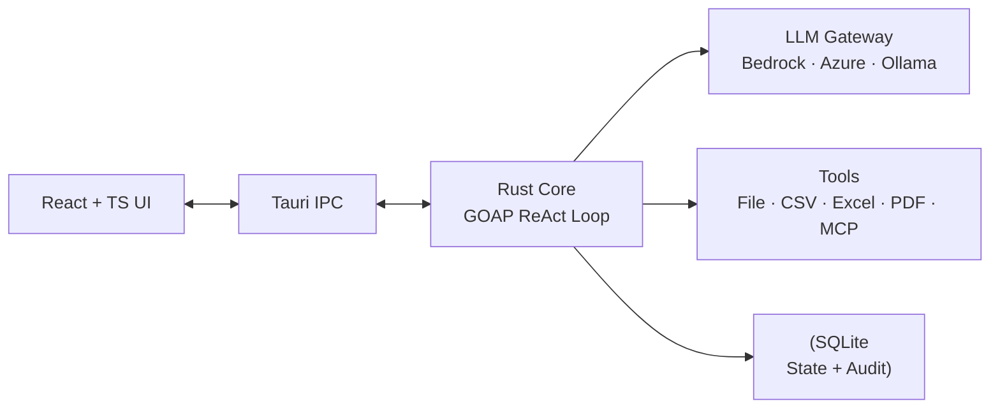
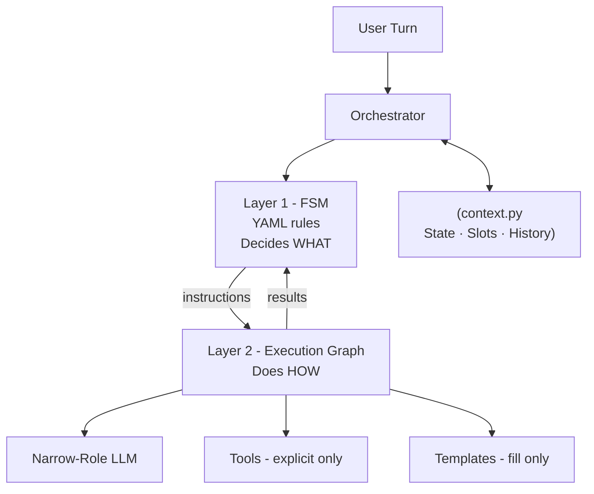
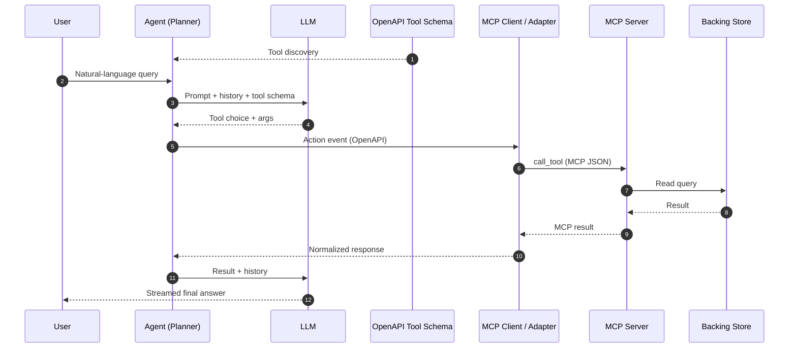
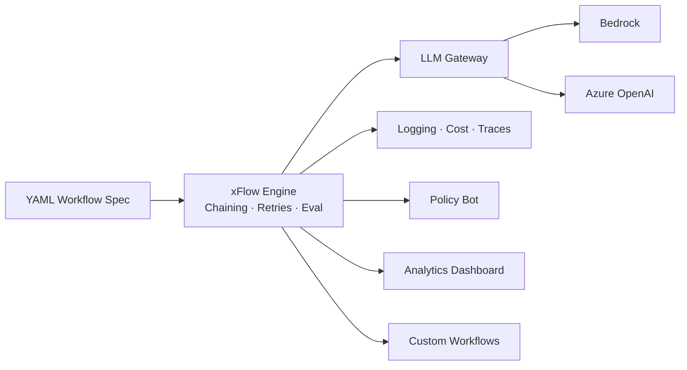
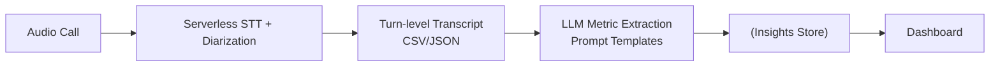

## 1. xAgents — Enterprise Agentic AI Platform | 2026 | Ongoing

* **Impact**: Built a desktop-first Agentic AI Platform letting non-developers create, govern, and operate AI agents safely — scaling to 100s–1000s of files per run.
* **Architecture**: Designed a sandboxed Tauri shell over a Rust core running a GOAP-inspired ReAct loop; agents declared via a 5-file YAML/Markdown spec.
* **Complexity / Trade-offs**: Chose Rust + Tauri over Python/Electron for GC-free latency, compile-time thread safety, and OS-level sandboxing; compliance is architectural — sensitive data stays on-device unless explicitly routed.
* **Tech Stack**: Rust (Tokio, `rig`) | Tauri 2 | React + TypeScript + Vite | SQLite | Bedrock · Azure OpenAI · Ollama

* **More Description**:
  * Each agent is defined by 5 files (`agent.yaml`, `agent.md`, `soul.md`, `context.md`, `memory.md`); a Guided Build Wizard walks non-coders through them.
  * Execution loop is bounded (max 15 iterations, 24K token window) and tool-aware — file I/O, CSV, Excel, PDF, MCP.
  * Multi-provider LLM gateway makes models swappable without touching agent code; context-window-based batching included

***

## 2. Restricted-Output Conversational AI Agent | Customer Service Automation | 2025–26

* **Impact**: Built a reliable, controlled, explainable customer-service agent validated across three concurrent use cases (booking, recall appointment, new car sales) on one orchestration backbone.
* **Architecture**: Designed a two-layer FSM system — YAML-declared FSM decides *what*, an execution graph does *how* — with a single `context.py` as runtime source of truth.
* **Complexity / Trade-offs**: Migrated off a Chain-of-Thought mega-prompt that worked only on frontier models; chose custom FSM 2-layer over a graph framework for debuggability and zero lock-in; strictly separated decisions from data so the LLM can never trigger a tool or transition implicitly.
* **Tech Stack**: Python | YAML-declared FSM | Node.js + Socket.IO | React + Vite | MongoDB | Azure OpenAI (GPT-4o)

* **More Description**:
  * Layer 1 (FSM) owns states, transitions, tool commands, template selection. Layer 2 (Execution Graph) handles narrow-role LLM calls (slot extraction, template filling) and explicit tool execution — *no* implicit decisions.
  * `context.py` centralizes state memory (current state, filled/missing slots, tool outputs, FSM instruction) + chat history — eliminating hidden state and cross-layer leakage.
  * UI controls (date pickers, vehicle selectors) are tightly coupled to FSM transitions so slot fulfilment via clicks, profile, or text is treated identically.
  * Scenario-driven evaluation (realistic + adversarial + recovery) surfaced routing leaks, slot-dependency bugs, and broken assumptions *earlier* than unit tests.
  * Automated 6-dimension Eval Agent produces turn-by-turn JSON defect reports — replacing unscalable human review.
  * Belief shifts that drove the architecture: *LLM + phases can guide flow → FSM must own decisions*; *Global phases scale → Use-case-local FSMs scale*; *Prompts + code → Declarative YAML*.
  * Adding a new use case = YAML + templates only; orchestration and execution code untouched — the strongest empirical signal the abstraction was right.

***

## 3. xPolicyBot — Agentic RAG Chatbot for Enterprise | HR · IT · InfoSec · Legal · Finance | 2025

* **Impact**: Delivered a role-aware, multilingual policy assistant with *every chunk source-cited* — the non-negotiable trust contract for policy guidance.
* **Architecture**: Architected an agentic RAG system with planning, reasoning, and reflection loops, extended with MCP-based tool execution so the agent can query structured systems, not just documents.
* **Complexity / Trade-offs**: Bridged OpenAPI-based tool schemas with the MCP JSON tool schema via an adapter layer — preserving a clean control-plane / data-plane boundary; later moved from managed agent orchestration to self-orchestrated RAG for finer control over planning, prompts, and cost.
* **Tech Stack**: AWS Bedrock (agent runtime, Claude Opus) | AWS OpenSearch (vector store) | MCP | OpenAPI / Action Groups | Amazon RDS

* **More Description**:
  * Differentiates answers by role profile (FTE, Intern, Retainer, Consultant, ICT); accessible via chat-platform app and a web UI.
  * Per turn, the agent decides whether to search memory, retrieve from the vector store, or invoke a tool — looping until a confidence/completeness check passes.
  * Tool discovery via OpenAPI keeps the agent stateless about its toolset — tools can be added/removed without redeploying.
  * The MCP-client adapter isolates transport translation in one place, so future tools (file systems, ticketing, internal APIs) plug in without touching the agent core.
  * Source-citation is a first-class output — the user is never asked to take the bot's word for it, which is what makes the system usable for compliance-sensitive queries.

***

## 4. xFlow — GenAI Workflow Platform | Internal Productivity Platform | 2024

* **Impact**: Led development of a unified GenAI platform that became the shared backbone for multiple downstream apps — a policy bot, a contact-center analytics dashboard, and YAML-driven workflow automation.
* **Architecture**: Designed an LLM-chaining engine driven by declarative YAML prompts, with a single provider gateway and shared observability, retries, and evaluation primitives.
* **Complexity / Trade-offs**: Standardized on YAML over code so workflows are reviewable and diff-able by non-engineers; isolated provider-specific behavior behind one gateway so models swap without rewriting workflows.
* **Tech Stack**: Python | YAML prompt DSL | AWS (Lambda · S3 · Bedrock) | LLM Provider Gateway (Bedrock + Azure OpenAI)

* **More Description**:
  * Cost of adding the third use case was a fraction of the first — the strongest empirical justification for treating this as a platform, not a script.
  * YAML-first prompt engineering converted prompt changes into reviewable pull requests, killing the *"prompt hidden in a notebook"* anti-pattern.
  * Common concerns solved once at the platform layer: provider abstraction, prompt versioning, chaining, retries, cost metering, logging, traces.
  * This platform is the direct ancestor of xAgents — the natural progression from *workflow chaining* to *autonomous, governed agents*.

***

## 5. Call Center Analytics Dashboard | Contact Center Intelligence | 2024

* **Impact**: Architected a speech-to-insight pipeline turning raw contact-center audio into agent-level performance metrics on a dashboard — replacing manual call-listening sampling with continuous automated analysis.
* **Architecture**: Designed a staged pipeline — audio → diarized turn-level transcript → LLM-driven metric extraction → persisted insights → dashboard — with each stage independently swappable.
* **Complexity / Trade-offs**: Started with an open-source PoC for diarization + STT and metric extraction; given low call volume, migrated to serverless managed APIs for both stages — cheaper to run, zero infra to maintain, and faster to evolve than self-hosted models.
* **Tech Stack**: AWS Transcribe (diarization + STT) | LLM API (metric extraction) | AWS (Lambda · S3) | Dashboard UI

* **More Description**:
  * **PoC vs. production**: open-source models proved feasibility, but with modest call volume the operational cost of self-hosting (GPU, monitoring, retraining) outweighed savings — managed APIs won on TCO and time-to-feature.
  * Decoupled **transcription** (commodity managed service) from **interpretation** (LLM-driven, where the value lives) so each can evolve independently.
  * Structured intermediate artifacts (CSV/JSON) between stages make the pipeline debuggable at every hop and trivial to replay against new prompts.
  * The "insight" stage is just a prompt template — adding compliance flags, sentiment trends, or QA scorecards is a prompt change, not a system change.
  * Every dashboard metric traces back to a specific turn in a specific transcript — the audit trail that makes downstream coaching and dispute resolution credible.

