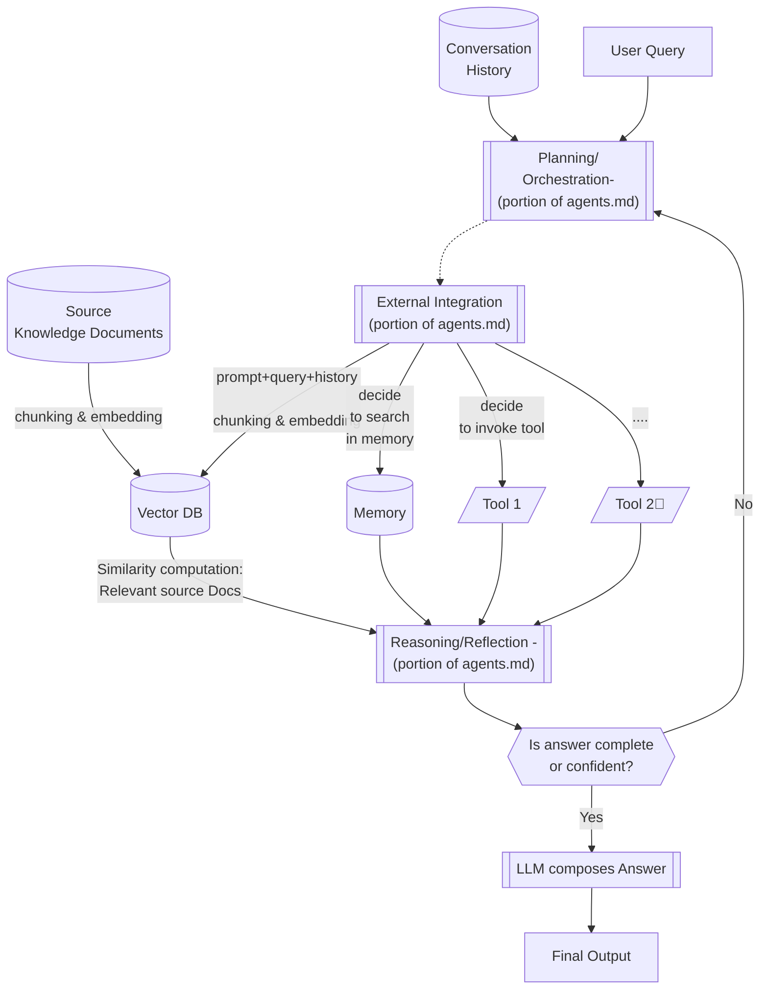
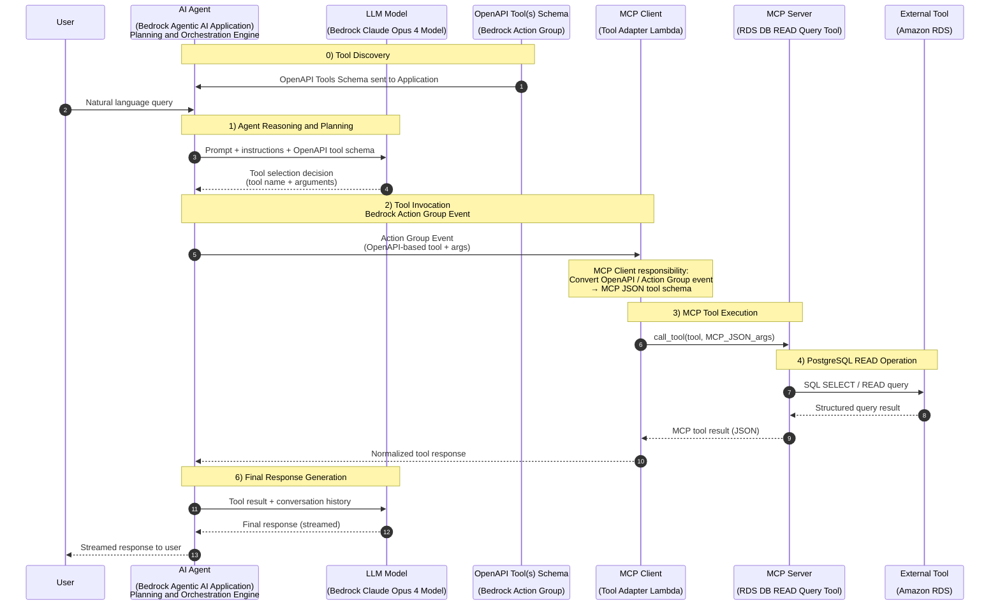

## Key Projects and their Architectures

### Agentic RAG Application | 2025
- Developed Agentic RAG application using Claude Opus model with
    - AWS Bedrock Agent powering the planning, reasoning, and reflection loops, and conversation memory, and 
    - AWS OpenSearch for vector database knowledgebase, and semantic retrieval 
- Extended the RAG architecture with MCP-tool execution: Integrated the Agent with OpenAPI-based Bedrock Action Groups, MCP tool execution to enable secure, production-grade tool-augmented inference

**How the Agentic RAG Application Works**:

**How the MCP is Integrated in the Agentic RAG Application**

